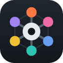

# HAOS local apps

Home Assistant add-ons by elmgdad. There is one so far: **Device Hub**.

## Device Hub

Device Hub puts Tuya, Tuya Local, Zigbee2MQTT, ZHA, Sonoff (SonoffLAN) and the devices on your network on one screen inside Home Assistant.

**In the panel**
- **All devices** in one list. Open any device to control it, rename it, set its area or see its history; filter by system and status; act on many devices at once.
- **Areas**: every room, with on/off for each device and for the whole room.
- **Automations**: every Home Assistant automation, with on/off and Run, plus a builder that makes new ones (at a time, at sunrise or sunset, or when a device changes).
- **A tab for each system**: Tuya (local keys, Tuya Local, IR remotes), Zigbee2MQTT, ZHA, Sonoff, and the network (scan and pairing hotspot).
- **Setup** checks what is connected and links to the fix. **Activity** logs commands, changes, automations, and devices going offline.

**For other apps**
- An **HTTP API** on port 8765 covering devices, areas, automations, scenes, activity and live Server-Sent Events.
- Keys can be **read**, **control** or **manage**, and can expire.
- Docs at `/api/v1`, **Swagger UI** at `/api/v1/swagger`, and an OpenAPI 3.1 document at `/api/v1/openapi.json`.
- An **MCP server** at `/mcp`, so Claude and other assistants can use the same keys.

## Install

1. In Home Assistant, open **Settings → Add-ons → Add-on Store → ⋮ → Repositories**.
2. Add `https://github.com/elmgdad/haos-devices-gateway`.
3. Install **Device Hub**, start it, and open it from the sidebar.

Device Hub needs the **Mosquitto** broker and the **MQTT** integration. For Tuya, sign in with the Smart Life app (your user code and a QR code), or with a cloud project on [iot.tuya.com](https://iot.tuya.com). Its **Setup** tab walks through the rest.

## Documentation

[device_hub/DOCS.md](device_hub/DOCS.md) covers configuration, every tab, removing devices, automations, the API, MCP, what is stored, troubleshooting and development. Home Assistant shows the same page in the add-on's Documentation tab.

Changes are in [device_hub/CHANGELOG.md](device_hub/CHANGELOG.md).
